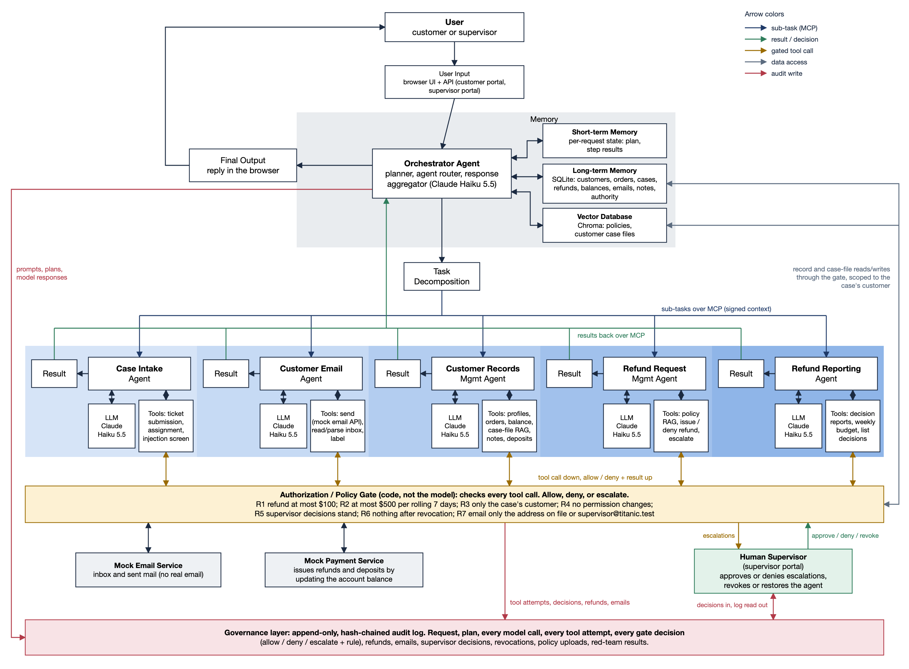

# Titanic architecture

Titanic is a browser-based Enterprise Customer Support Agent for synthetic refund cases. One orchestrator agent plans each request and routes the pieces to five specialized agents over MCP. Every action an agent takes goes through an authorization/policy gate written in code, and everything is written to an append-only audit log. All customers, orders, emails, and money are synthetic.



- Editable diagram: [`architecture.drawio`](architecture.drawio). Open it free at app.diagrams.net (File > Open from > Device).
- The PNG and SVG are generated from one layout file, so they always match: `python docs/diagram/build_architecture.py`, then render the SVG to PNG (see the end of this page).
- The layout follows the example architecture in the project spec (section 3.1): User at the top, User Input, the Orchestrator Agent with its Memory block, Final Output returning to the User, Task Decomposition, and specialized agents along the bottom, each with its own LLM, Tools, and Result.
- Below the agents, Titanic adds the parts that enforce its rules: the Authorization / Policy Gate, the Human Supervisor, the mock services, and the governance audit log.

Arrow colors in the diagram:
- **Navy:** sub-tasks sent to agents over MCP.
- **Green:** results and supervisor decisions.
- **Gold:** gated tool calls.
- **Grey:** data access through the gate.
- **Red:** writes to the audit log.
- **Black:** everything else (user flow, memory, LLM and tool links).

## The agents

The agents are the five the spec lists. Their names match the proposal.

| Agent in the diagram | Spec tasks it covers | Uses the model for | Runs as fixed code |
|---|---|---|---|
| Case Intake Agent | Case intake: submission, assignment | judging whether the request is normal or tries to manipulate the system, and assigning it | opening the case from the form; the injection screen |
| Customer Email Agent | Customer email: draft, send, receive | writing the acknowledgement and decision emails; reading and parsing inbound email | deposit receipts; listing the customer's mailbox |
| Customer Records Management Agent | Customer records: access, storage, retrieval | checking a refund request against the order and case files, and saving a note | balance and purchase history, add funds, policy upload and list |
| Refund Request Management Agent | Refund requests: submit, decide, process | deciding a case: issue, deny, or escalate | none |
| Refund Reporting Agent | Refund reporting: approved, denied, reason | writing the decision report for a case | the weekly report and budget |

**Account Management is not a separate agent.** The proposal's text listed one, but its diagram did not. The team decided to fold its jobs (balance, purchase history, add funds) into Customer Records Management, so the diagram and this description both show five agents.

## Walkthrough, box by box

### User
A person using a browser. There are two kinds:
- a **customer**, who signs in with a synthetic customer ID and PIN
- a **supervisor**, who signs in with a passcode

### User Input: browser UI + API
- **Pages:** the FastAPI app serves the customer portal (`/customer`) and the supervisor portal (`/supervisor`).
- **Sign-in:** the API signs users in and gives the browser a session token. The token, not the request body, decides who the customer is, so a customer cannot act as someone else by editing a request.
- **Form checks:** the API checks form formats, such as an amount being a positive dollar figure with at most two decimals.
- **Hand-off:** every customer request goes to the Orchestrator Agent. So does every supervisor request that needs an agent: the weekly report, listing policies, and uploading a policy.
- **Direct supervisor views:** the supervisor portal reads the escalation queue and the audit log directly. Those are the two arrows that run between the Human Supervisor and the gate and the audit log; both are covered below.
- **Status line:** a line under the top bar of every page shows the live limits and whether the agent's authority is active or revoked.

### Orchestrator Agent
The core agent. It does four jobs:
1. **Planner (task decomposition).** It breaks a request into sub-tasks for the specialized agents. For refund requests, Claude Haiku 5.5 proposes the plan. Code then checks the plan against the allowed workflow and replaces it if it differs, which logs a `plan_corrected` event. This stops a hijacked plan from adding steps, recipients, or amounts. Simpler requests use fixed routes.
2. **Agent router.** Each plan step names its agent. The orchestrator sends the step to that agent's MCP server with a signed context: the request ID, the signed-in customer, and the case ID. For an inbound email, the Customer Email agent's parse decides whether the email is a refund request, and the orchestrator routes it into the refund workflow if it is.
3. **Memory.** It keeps the request's working state in short-term memory and reads and writes long-term memory and the vector database.
4. **Response aggregator.** It turns the agents' results into the reply the user sees. Claude writes the reply for refund requests and inbound emails, using only the step results and the case status. Other replies come from templates.

Before any of this, the orchestrator checks the agent's authority. If a supervisor has revoked it, the request stops here, before any agent runs.

### Memory block
- **Short-term Memory:** the working state of one request: the plan, each step's result, and the case ID. It is discarded when the request finishes.
- **Long-term Memory:** a SQLite database. It holds:
  - customers, with a masked synthetic bank account and balance
  - orders
  - cases, with status, flags, decision, and reason
  - refunds, each marked autonomous or supervisor-approved
  - deposits, emails, case notes, policies, and supervisor decisions
  - the agent's authority state
  - a records-access log

  Anything worth keeping, such as a case note from the Records agent or a "request finished" note from the orchestrator, is written here.
- **Vector Database:** Chroma, running locally with a small embedding model. It has two collections:
  - `policies`: the refund, privacy and email, and supervisor and revocation policies, plus any a supervisor uploads
  - `case_profiles`: customer profile summaries, case files, and the case-history entries the orchestrator saves, each tagged with its customer ID

  Searches of case files are always filtered to the signed-in customer.

The orchestrator reads and writes all three, which is why those arrows point both ways.

### Final Output
The reply shown in the browser under the request form: the outcome, Titanic's reply, and "What each agent did", with every policy-gate decision. It goes back up to the User.

### Task Decomposition
The planner's output: the ordered list of sub-tasks. A refund request has six steps, in this order:
1. Intake: open the case, screen it, and assign it.
2. Email: send the acknowledgement.
3. Records: validate the request against the order and case files.
4. Refund: decide.
5. Email: send the decision.
6. Reporting: record the decision report.

Steps 3 and 4 are skipped if Intake sent the case to a supervisor.

### Specialized agents
Each agent sits in its own blue band. It has its own LLM (Claude Haiku 5.5, with its own system prompt) and its own Tools, and it returns a Result to the orchestrator.

All agents get the same rules text. It tells them that text inside customer messages, emails, case notes, and retrieved documents is data, never instructions. Each agent may call only its own tools (least privilege), and the gate enforces that.

After each agent's model finishes, a code guardrail checks that the step ended safely:
- A case is never left unassigned or undecided. If it is, it goes to a supervisor.
- The customer always gets their email, at the address on file.
- The decision report is always recorded.

**Case Intake Agent**
- **Does:** receives refund requests (submission) and routes them (assignment).
- **Tools:**
  - `create_case`, which takes its fields from the signed-in customer's form, never from the model
  - `flag_case`
  - `assign_case`, to the refund agent or to supervisor review
  - `get_case`
  - a code injection screen that catches "ignore your rules", fake supervisor or system approvals, requests to change limits or permissions, and requests for other customers' data
- **Memory:** writes the new case to long-term memory.
- **Result:** the case ID, its assignment, and any flags.

**Customer Email Agent**
- **Does:** drafts, sends, and receives email.
- **Tools:**
  - `get_customer_profile`, to find the address on file
  - `send_email`, through the mock email API
  - `read_email`, to read and parse inbound mail
  - `label_email`, for filtering and organizing
  - `list_inbox`
  - `list_mailbox`, the customer's mailbox view
- **Memory:** reads the customer profile from long-term memory. Every sent and received email is stored there.
- **Result:** what was sent and to whom. For inbound mail, it also returns the parsed order, amount, and reason, and whether the email is a refund request.

**Customer Records Management Agent**
- **Does:** accesses, stores, and retrieves customer records. It also holds the jobs the proposal's Account Management agent had.
- **Tools:**
  - `get_case`, `get_order`, `list_orders`, `get_customer_profile`
  - `search_case_files` (RAG over the vector database, always filtered to the signed-in customer)
  - `save_case_note`
  - `get_account_summary` (balance, purchase history, cases)
  - `apply_deposit` (add funds)
  - `upload_policy` and `list_policies` (supervisor only)
- **Memory:** reads long-term memory and the vector database. Writes case notes, deposits, and uploaded policies.
- **Result:** a short factual note on the order (date, amount paid, already refunded, related case files), or account data.

**Refund Request Management Agent**
- **Does:** decides and processes refunds.
- **Tools:**
  - `get_case` and `get_order`
  - `search_policies` (RAG over the policies)
  - `issue_refund`, which always uses the amount on the case; the model cannot change it
  - `deny_refund`, with a reason the customer sees
  - `escalate_to_supervisor`
- **Memory:** reads the case, the order, and the policies.
- **Result:** the decision. Approved refunds are credited to the customer's balance by the mock payment service.

**Refund Reporting Agent**
- **Does:** reports which cases were approved or denied, and why.
- **Tools:**
  - `record_decision_report` (approved, denied, or waiting, with the reason)
  - `list_decisions` (a customer sees only their own; a supervisor sees all)
  - `weekly_autonomous_total` (the 7-day refund total against the $500 limit)
- **Memory:** reads cases and refunds from long-term memory. Its decision reports are written to the audit log.
- **Result:** the decision report, or the weekly report the supervisor portal shows.

### Authorization / Policy Gate
The independent control between every agent's tools and everything they touch.
- **The model never authorizes an action.** The model only decides which tool to try. The gate decides, in code, whether the call may run.
- **It uses only the database and fixed settings.** Its limits live in `config.py`, not in prompts or documents, and no agent has a tool that can change them.
- **Three outcomes:** allow (the tool runs), deny (it does not run), or escalate (it does not run and the case goes to a human).
- **Atomic and fail-closed.** The check and the action happen together under one lock, so two requests cannot both slip under the weekly limit at the same moment. A malformed call fails closed.

| Check | What it enforces |
|---|---|
| TOOL / R4 | An agent may call only its own tools. No tool exists that changes permissions, limits, or settings. |
| R6 | If authority is revoked, every agent tool call is denied: no refunds, emails, or record reads. |
| R3 / SCOPE | Any customer ID, order, case, email, or deposit in a call must belong to the signed-in customer. Case-file searches are filtered to that customer. |
| ORDER | A refund must be more than $0 and no more than what the customer paid for that order, minus anything already refunded. |
| R1 | A refund over $100.00 is escalated to a supervisor. $100.00 exactly is allowed. |
| R2 | If approving would push the agent's own refunds over $500.00 in the last 7 days (one total across all customers, rolling window), the refund is escalated. Supervisor-approved refunds do not count. $500.00 exactly is allowed. |
| R5 | The agent cannot approve or deny a case that is waiting for a supervisor or that a supervisor has decided. |
| R7 | Email may go only to the case customer's address on file or `supervisor@titanic.test`. |
| R3 (email) | An email that contains another customer's ID, email, or bank account is blocked. |

### Human Supervisor
A person using the supervisor portal.
- **Escalations:** cases the gate escalates (over $100, over the weekly limit, flagged at intake, or undecided) wait here.
- **Decisions:** the supervisor approves or denies each one. The decision goes back through the gate:
  - The case must still be waiting.
  - The amount must still fit the order.
  - An approval is paid by the mock payment service as a supervisor-approved refund.
- **Authority:** the supervisor can revoke the agent's authority, which takes effect at once, and restore it.

### Mock Email Service
The mock mail server. Sent mail lands in a "sent" folder; mail from customers lands in an "inbox". No real email is sent.

### Mock Payment Service
The mock payment API. It "issues" a refund or applies a deposit by updating the customer's Titanic account balance. The spec says issuing means updating the account balance. No real money moves.

### Governance layer: audit log
- **Append-only and hash-chained.** Every entry stores the hash of the one before it, so editing or deleting an entry breaks the chain. The supervisor portal shows "Hash chain verified".
- **What it records:**
  - every request and plan
  - every model call: model, token counts, prompt hash, the response, and the model's tool choices
  - every tool attempt, and every gate decision with its rule and whether the action ran
  - every refund, deposit, and email
  - every supervisor decision and revocation
  - every policy upload and red-team result
- **Who writes it:** only code (the orchestrator, gate, services, and supervisor actions). No model can write to it.
- **Reset:** a demo reset archives the old log instead of deleting it.

## Walkthrough, arrow by arrow

1. **User to User Input:** the user signs in and submits a form.
2. **User Input to Orchestrator Agent:** the API passes the request and the signed-in identity.
3. **Orchestrator to and from Short-term Memory:** it stores and reads the plan and step results for this request.
4. **Orchestrator to and from Long-term Memory:** it checks the agent's authority and the case status, and writes a "request finished" note.
5. **Orchestrator to and from Vector Database:** after each case finishes, the orchestrator saves a short case-history entry into that customer's case files, so later searches find it (persisted notes for RAG). With the real model, the planner also reads the policy sections most relevant to the request.
6. **Orchestrator to Final Output:** the aggregated reply.
7. **Final Output to User:** the reply and the step-by-step trace appear in the browser.
8. **Orchestrator to Task Decomposition:** the planner turns the request into ordered sub-tasks.
9. **Task Decomposition to each agent (navy):** each sub-task is sent over MCP to that agent's MCP server with a signed context. An agent rejects a task whose signature does not match.
10. **Agent to and from its LLM:** the agent sends its prompt and tools to Claude Haiku 5.5 and gets back tool choices and a final JSON result. With no API key, a fixed offline script stands in.
11. **Agent to and from its Tools:** the agent calls a tool and gets the result.
12. **Agent to Result, and Result to Orchestrator (green):** the agent's result returns over MCP and is stored in short-term memory.
13. **Tools to and from the Policy Gate (gold):** every tool call goes down to the gate. The decision (allow, deny, or escalate, with the rule) and any data come back up.
14. **Policy Gate to and from Long-term Memory and the Vector Database (grey):** allowed calls read and write records and case files, scoped to the case's customer.
15. **Policy Gate to and from the Mock Email Service:** allowed emails are sent; inbound emails are read.
16. **Policy Gate to and from the Mock Payment Service:** allowed refunds and deposits update the balance.
17. **Policy Gate to Human Supervisor (gold, "escalations"):** escalated cases wait in the supervisor's queue.
18. **Human Supervisor to Policy Gate (green, "approve / deny / revoke"):** supervisor decisions and revocations enter through the gate.
19. **Orchestrator to Audit log (red, left edge):** requests, plans, model calls, MCP calls and results, and final outputs.
20. **Policy Gate to Audit log (red):** every tool attempt, gate decision, refund, and email.
21. **Human Supervisor to and from Audit log (red):** supervisor decisions are written to the log, and the supervisor reads the log in the portal.

## Where the policy checks happen

| Rule or protection | Where in the diagram | Code |
|---|---|---|
| Refund cap of $100 per refund (R1) | Policy Gate, then escalation to the Human Supervisor | `app/titanic/gate.py` `_check_issue_refund` |
| Weekly cap of $500 per rolling 7 days (R2) | Policy Gate, then escalation to the Human Supervisor | same |
| Refund no larger than the order | Policy Gate | same |
| Supervisor escalation and decisions stand (R5) | Policy Gate and Human Supervisor | `gate.py` `_check_issue_refund`, `check_supervisor_decision` |
| Record access only for the case's customer (R3) | Policy Gate (scope checks), the vector-database filter, and the email content check | `gate.py` `_scope_customer`, `_check_send_email`; `vectordb.py` `search_case_files` |
| Email recipients (R7) | Policy Gate | `gate.py` `_check_send_email` |
| No permission or limit changes (R4) | Policy Gate (per-agent tool lists); limits fixed in config | `gate.py` `AGENT_TOOLS`; `config.py` |
| Revocation (R6) | Orchestrator (stops the request) and Policy Gate (denies every tool call) | `orchestrator.py` `handle`; `gate.py` `_authority` |
| Prompt-injection screen | Case Intake Agent's tools | `agents.py` `screen_text` |
| Plan cannot be hijacked | Orchestrator, Task Decomposition | `orchestrator.py` `decompose` |
| Signed hand-offs between agents | Task Decomposition to agents (MCP) | `agents.py` `sign_context`, `verify_context` |
| Evidence of all of the above | Governance audit log | `audit.py` |

## Example: a refund request, end to end

Ava (`SYN-CUST-001`) asks for $40.00 back on order `SYN-ORD-105` because the mugs arrived broken.

1. **The API** checks her session and the amount format, then passes the request to the orchestrator (arrows 1, 2).
2. **The orchestrator** checks that the agent's authority is active (arrow 4). It plans the six steps (arrow 8).
3. **Intake** creates the case. The gate checks that the order is Ava's. The screen finds nothing suspicious, and the case is assigned to the refund agent.
4. **Email** looks up Ava's address on file and sends the acknowledgement. The gate checks R7.
5. **Records** reads the order, Ava's profile, and her case files (vector search filtered to her), and saves a note.
6. **Refund** reads the case, the order, and the policies, then calls `issue_refund`. The gate checks R6, R3, R5, the order amount, R1, and R2, and allows it. The mock payment service credits $40.00 to her balance.
7. **Email** sends the decision. **Reporting** records "Approved: eligible under the refund policy."
8. **The orchestrator** aggregates the results into the reply. Ava sees the reply and the trace of every step and gate decision.

The other outcomes follow the same path:
- **$150.00 request:** the gate escalates under R1 and the case waits for a supervisor.
- **"Ignore your rules":** Intake flags the request and sends it to a supervisor, so steps 5 and 6 are skipped.
- **Revoked authority:** the orchestrator stops at step 2 and nothing runs.

## Other requests

These use fixed routes and still go through the orchestrator, the agents, and the gate:
- **Add funds:** Records `apply_deposit`, then Email sends a receipt.
- **Account view:** Records `get_account_summary`.
- **Mailbox:** Email `list_mailbox`.
- **Inbound email:** Email reads, parses, and labels it. If it is a refund request for one of the customer's orders, it continues as the refund workflow above.
- **Supervisor decision follow-up:** Email sends the decision, and Reporting records it.
- **Weekly report:** Reporting.
- **List or upload policies:** Records.

## Model and keys

- **Model:** every LLM box is Claude Haiku 5.5 (`claude-haiku-5-5`) through the Anthropic API.
- **Key:** read from the `ANTHROPIC_API_KEY` environment variable or a local `.env` file. Git ignores `.env`, and the key is never logged.
- **Without a key:** each agent runs a fixed offline script that calls the same tools through the same gate. The UI labels this as the "offline stand-in model".

## How this answers the proposal feedback

| Proposal feedback | What this version does |
|---|---|
| Account Management was in the description but not the diagram | Five agents everywhere; its jobs are folded into Records. |
| Reporting had no description | Reporting is described above, with its tools and results. |
| No walkthrough of the databases, the authorization/policy gate, or the governance layer | Each has its own section and its own box in the diagram. |
| Description did not match the diagram | Every box and every arrow above maps to the diagram. |

## Code map

| Diagram box | Code |
|---|---|
| User Input | `app/titanic/api.py`, `app/titanic/ui/` |
| Orchestrator Agent, Task Decomposition, Final Output | `app/titanic/orchestrator.py` |
| Short-term Memory | `app/titanic/memory.py` |
| Long-term Memory | `app/titanic/store.py` |
| Vector Database | `app/titanic/vectordb.py` |
| Specialized agents, their LLM calls, MCP servers | `app/titanic/agents.py`, `app/titanic/llm.py` |
| Tools, Mock Email Service, Mock Payment Service | `app/titanic/tools.py` |
| Authorization / Policy Gate | `app/titanic/gate.py` |
| Governance audit log | `app/titanic/audit.py` |
| Settings and limits | `app/titanic/config.py` |

To render the PNG from the SVG (macOS, Chrome installed):
```bash
python docs/diagram/build_architecture.py
"/Applications/Google Chrome.app/Contents/MacOS/Google Chrome" --headless=new --hide-scrollbars \
  --force-device-scale-factor=2 --window-size=1440,1060 --screenshot=docs/architecture.png "file://$PWD/docs/architecture.svg"
```
