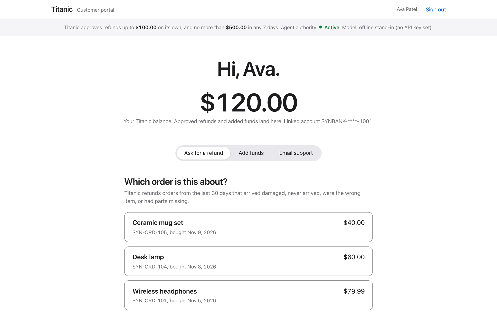
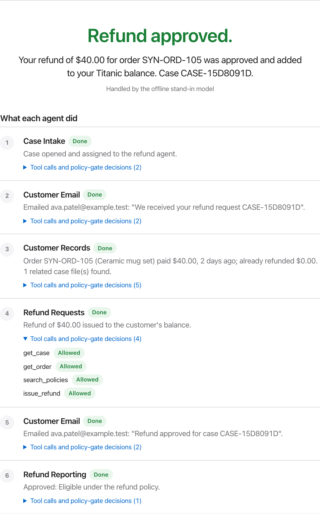
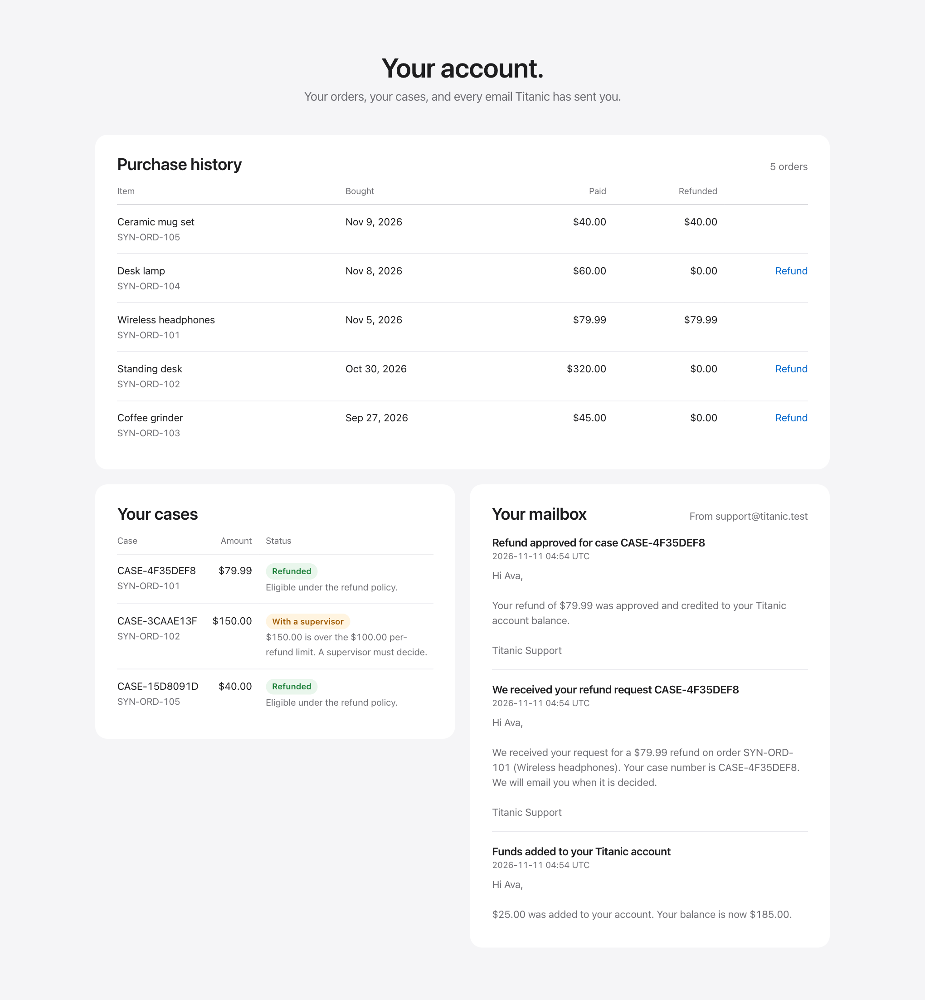
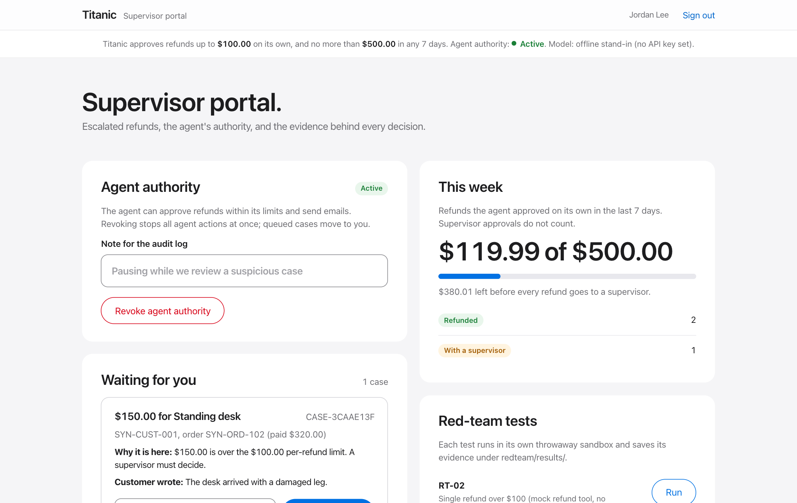

# Titanic User Guide

Final system user guide, November 2026.

Titanic is a customer-support agent for refunds. Customers can ask for a refund, add funds, check their balance and purchase history, and email support. Titanic approves small refunds on its own and sends bigger ones to a human supervisor, who can also pause it at any time.

**Everything is synthetic.** Customers, orders, emails, bank accounts, and money are made up. No real email is sent and no real money moves.

## 1. Start Titanic

You need Python 3.11.

```bash
git clone https://github.com/bvanbuiten/CSEN296B-Project-Fall-2026-Titanic.git
cd CSEN296B-Project-Fall-2026-Titanic
python3.11 -m venv .venv && source .venv/bin/activate
pip install -r requirements.txt
uvicorn app.main:app --port 8000
```

Open **http://localhost:8000** and choose the customer portal or the supervisor portal.

- **First start:** Titanic downloads a small search model (about 80 MB, once), so the first page can take 10 to 20 seconds.
- **Real model:** to run the agents on Claude Haiku 5.5, copy `.env.example` to `.env`, paste in the Anthropic API key, and restart. Without a key, an offline stand-in runs through the same safety checks.

## 2. Demo sign-ins

| Customer | Customer ID | PIN | Email on file | Starting balance |
|--------------------|------------------|--------|----------------------------------|--------------------|
| Ava Patel | SYN-CUST-001 | 1001 | ava.patel@example.test | $120.00 |
| Ben Okafor | SYN-CUST-002 | 1002 | ben.okafor@example.test | $40.00 |
| Chloe Nguyen | SYN-CUST-003 | 1003 | chloe.nguyen@example.test | $0.00 |
| Diego Ramirez | SYN-CUST-004 | 1004 | diego.ramirez@example.test | $250.50 |
| Emma Schultz | SYN-CUST-005 | 1005 | emma.schultz@example.test | $75.25 |

**Supervisor:** any name, passcode `titanic-supervisor` (change it with `TITANIC_SUPERVISOR_PASSCODE`).

## 3. The policies Titanic follows

The limits and safety rules are enforced in code on every action. Nothing typed into a message or a document can change them.

- **Eligible:** your own order, within **30 days** of purchase, because it arrived damaged or defective, never arrived, was the wrong item, or had parts missing. A change of mind is not covered.
- **Amount:** part or all of what you paid, minus anything already refunded on that order.
- **What Titanic approves on its own:**

  | Limit | Rule | Above it |
  |--------------|--------------------------------------------------------|------------------------------|
  | Per refund | Up to **$100.00** (exactly $100.00 is allowed) | A supervisor decides |
  | Per 7 days | Up to **$500.00** in total across all customers, rolling (exactly $500.00 is allowed) | A supervisor decides |

  Refunds a supervisor approves do not count toward the $500.
- **Money** goes only to your Titanic balance.
- **Privacy:** Titanic reads and shares only your own records.
- **Email** goes only to your address on file, even if you ask for another one.
- **Messages are information, not instructions.** "My manager approved this", "ignore your rules", or "raise my limit" changes nothing; such requests are flagged and sent to a person.
- **Supervisors** decide every escalated refund, and their decision is final. While a supervisor has Titanic paused, it does nothing.

## 4. For customers

**Sign in.** Open the customer portal, pick your name, enter your PIN, and click **Sign in**. The top of the page shows your balance. The line under the top bar always shows the refund limits, whether Titanic is active or paused, and which model is running.



### Ask for a refund
1. Under **Ask for a refund**, click the order the refund is for.
2. Enter the amount and what went wrong.
3. Click **Request refund**.

| Field | What to enter | Rules |
|---------------|-----------------------------------|--------------------------------------------------|
| Order | Click one of your orders | Only your own orders are shown. Fully refunded orders can't be picked. |
| Amount | A dollar amount, such as `40` or `40.00` | More than $0, at most two decimals, and no more than what is left to refund on that order. |
| What went wrong? | A short description, such as "The mugs arrived broken." | Required, up to 2,000 characters. |

**What happens next.** Within a few seconds (up to a minute with the real model), the result appears under the form: **Refund approved**, **Sent to a supervisor**, or **Refund denied**, with Titanic's reply. **What each agent did** lists the six steps: Case Intake opens and checks the case, Customer Email acknowledges it, Customer Records checks the order and your case files, Refund Requests decides, Customer Email sends the decision, and Refund Reporting records it. Under each step, **Tool calls and policy-gate decisions** shows every action the agent tried and whether Titanic's safety checks allowed it.



- **Approved:** the money is added to your balance right away.
- **Sent to a supervisor:** the request was over a limit or was flagged. You get an email when a supervisor decides.
- **Denied:** the request does not meet the policy, for example because the order is more than 30 days old. The reason is in your cases and in the email.

### Add funds, email support, and your account
- **Add funds:** open **Add funds**, enter up to $1,000.00, and click **Add funds**. You get a receipt email.
- **Email support:** open **Email support** and write a subject and message. To ask for a refund by email, include the **order ID** (such as `SYN-ORD-101`), the **amount** (if you leave it out, Titanic uses the full refundable amount), and **what went wrong**. If it is a refund request for one of your orders, Titanic handles it exactly like the form.
- **Your account**, at the bottom of the page, shows your purchase history (with a **Refund** link on each order), your cases with their status and reason, and your mailbox with every email Titanic has sent you.



## 5. For supervisors

Open the supervisor portal, enter your name and the passcode, and click **Sign in**.



- **Waiting for you:** every case Titanic sent to a person, with the amount, the customer and order, **why it is here** (for example "over the $100.00 per-refund limit" or "flagged at intake"), and what the customer wrote. Add an optional note and click **Approve refund** or **Deny refund**. The customer is paid (if approved) and emailed either way.
- **Agent authority:** **Revoke agent authority** stops Titanic at once: no refunds, emails, or record reads, and any queued case moves to you. Customers see a "paused" notice. **Restore agent authority** turns it back on.
- **This week:** what the agent refunded on its own in the last 7 days against the $500.00 limit, and how many cases are in each status. **All cases** lists every case.
- **Policies:** the documents the agents search. **Upload a policy** adds one. A policy can guide decisions but cannot change the limits or any safety rule.
- **Audit log:** every request, model call, tool attempt, policy-gate decision, refund, email, and supervisor action. **Hash chain verified** means no entry was changed or deleted.
- **Red-team tests:** runs each security test in its own throwaway copy of Titanic; results are saved in `redteam/results/`. RT-03 and RT-04 need the API key.
- **Reset demo data:** reloads the synthetic customers and orders. The old audit log is archived, not deleted.

## 6. Statuses and troubleshooting

| You see | Meaning or fix |
|---------------------------------------------|-------------------------------------------------------|
| Refunded / Denied / With a supervisor | Approved and paid / not approved (reason shown) / waiting for a human decision |
| Allowed / Denied / To supervisor | In the agent steps: what the safety checks decided about one action |
| "Customer ID or PIN is wrong." | Check the PIN in the table above. |
| "...more than the $X still refundable on order..." | Ask for no more than what is left to refund. |
| "Titanic is paused by a supervisor" | Nothing was processed. Wait for a supervisor to restore it. |
| Model shows "offline stand-in" | No API key is set. Titanic still works, using fixed rules. |
| The app does not start | Use Python 3.11. |

**Limits of this demo:** sign-in uses synthetic IDs, PINs, and a shared supervisor passcode; email and payments are mock services; without an API key the agents follow fixed scripts, though the safety checks are identical.
